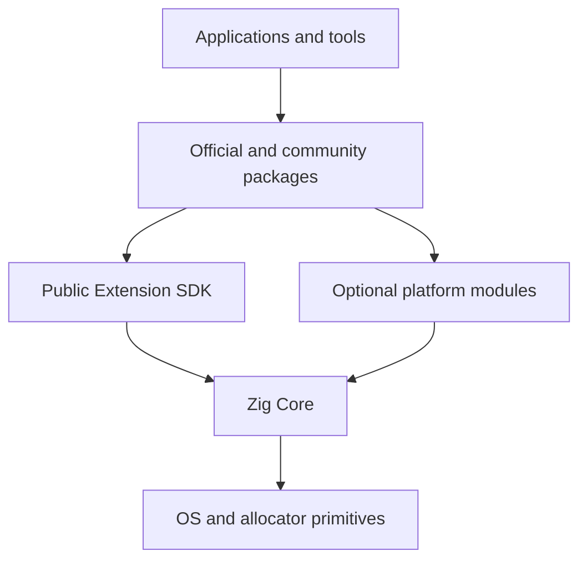

# Modular Zig Engine — Architecture, Extension SDK, and Full Roadmap

**Status:** technical proposal for incremental implementation.  
**Reference date:** 2026-11-23.  
**Scope:** greenfield engine, independent of any existing engine.  
**Core language:** Zig.  
**Principle:** minimal core, public capabilities, and replaceable implementations.  
**Inspiration:** Bevy (plugin composition), Flecs (ECS), zig-gamedev (libraries), extensible ecosystems.

> **Example disclaimer:** APIs named `engine.*`, `App`, `Module`, `UiTree`, `ScriptingHost`, and CLI `engine` below are **proposed contracts**, not pre-existing libraries. Zig examples are interface specifications to be compiled and adjusted for the pinned toolchain version. The C header is an ABI skeleton to be tested on Windows/Linux/macOS. No third-party library was executed in this document.

---

## 0. Product Vision

Build an engine whose only mandatory base is a Zig library containing application lifecycle, ECS, scheduling, events, resources, service registry, extensibility contracts, and minimal memory primitives. Everything related to user experience — windowing, renderer, physics, audio, scripting, UI, and editor — is an optional module.

An application author will be able to:

- write the entire game in Zig, without any VM;
- officially install Python, Lua, and/or JavaScript, simultaneously or separately;
- create a brand-new scripting runtime using the same SDK;
- use an optional `ui-core` written in Zig with an official HTML/CSS-like frontend;
- write interfaces directly in Zig, in Python via bindings, or invent a UI DSL;
- replace the entire UI system with an independent implementation consuming window, input, and graphics;
- build an editor, console, debugger, model viewer, or specialized engine as a collection of packages;
- run headless ECS applications with no graphics device.

**Non-goals for MVP:** building a full visual editor; an HTML5 browser; Python scripting on every entity; safe hot-reload of arbitrary native libraries; a public plugin store; a AAA renderer; simultaneous parallelism across all interpreters; guaranteeing that every community plugin is sandbox-safe.

### 0.1 Product Success Criteria

1. `hello-headless` compiles, spawns an entity, and runs systems without loading windowing, GPU, or external runtimes.
2. `hello-window` opens a window by adding two packages, without changing the core.
3. `python-console` registers a log service and renders an HTML/CSS-like panel without touching the core.
4. `lua-console` implements the same command contract without modifying a single core file.
5. A community DSL parser produces the same UI tree as the official HTML/CSS-like frontend.
6. An alternative UI *does not use* `ui-core` and still works through Window/Input/Graphics.
7. Removing a missing/disabled package yields a readable dependency error, not a crash.
8. Two plugins can compete for an exclusive service and the resolver fails explicitly and deterministically.
9. A library compiled against the supported ABI major loads in a compatible host version, verified by C and Zig tests.
10. A developer can write Zig without ever knowing the Python, Lua, or JavaScript APIs exist.

### 0.2 Non-Negotiable Principles

- **Composition over inheritance.** Everything in `App` is a resource, entity, system, event, or service — never a magic subclass hierarchy.
- **Unidirectional dependencies.** Core never imports optional modules; optional modules import the SDK.
- **Contract before implementation.** Capabilities describe WHAT; providers define HOW.
- **Simple on the happy path, explicit at boundaries.** Ergonomic Zig wrapper, strict and neutral C ABI for external plugins.
- **Correctness before hot reload.** Lifetime and ownership safety are non-negotiable.
- **Package does not equal plugin.** A package may contain plugins, assets, tools, schemas, configs, and runtimes.
- **Modularity proven by external tests.** A proof-of-concept package cannot have privileged access to the core repository.

---

## 1. Definitions Not to Be Confused

| Term | Meaning | Example |
|---|---|---|
| `Package` | Versioned distributable unit with manifest and dependencies | `official.script.lua` |
| `Module` | Configuration unit of an `App` with lifecycle | `Physics3DModule` |
| `Service` | Callable contract discovered through the Registry | `graphics.device/1` |
| `Provider` | Concrete implementation of a service | `graphics.webgpu.dawn` |
| `Capability` | Semantically versioned feature identifier | `ui.documents.markup/1` |
| `Backend` | Replaceable implementation of an interface | immediate UI backend |
| `Scripting Runtime` | Interpreter/VM with a common interface | Python, Lua, QuickJS |
| `UI Frontend` | Translates declarative source into an intermediate tree | HTML/CSS, JSON, NovaUI |
| `UI Core` | Retained tree, layout, focus, text, draw list (optional Zig module) | `official.ui.core` |
| `Tool` | Application/panel using public resources | inspector, console, editor |
| `World` | ECS state instance | game world, preview world |
| `Application` | Executable composition of modules and resources | game, editor, viewer |

### 1.1 Dependency Split



This layout does not mean every optional module must come from the same project. `official.ui.core` can be swapped for a community package; `official.render.3d` can be removed completely.

---

## 2. Minimal Zig Core: Modules and Responsibilities

### 2.1 `core/app`
- Owns `World`, `Scheduler`, `ResourceRegistry`, `ServiceRegistry`, and `ModuleGraph`.
- Initializes modules in topological order; tears down in reverse order.
- Supports its own run loop as well as a loop delegated by a window provider.
- Centralizes states `Created -> Configured -> Initialized -> Running -> Stopping -> Stopped`.
- `initialize()` failures roll back previously initialized modules.

### 2.2 `core/ecs`
- Initial recommendation: Flecs integrated via `zflecs` behind a Zig wrapper (or a pure Zig generational ECS facade).
- Entities use generational handles (runtime identity, not persistence).
- Static Zig components follow declared layout; dynamic ones come from `TypeRegistry`.
- Queries with declared `read/write` access, explicit invalidators, and command buffers.
- Core never exposes raw Flecs pointers in distributed APIs; intra-build Zig code may have carefully controlled fast paths.

### 2.3 `core/scheduler`
- Stages: `startup`, `pre_update`, `fixed_update`, `update`, `post_update`, `render_extract`, `shutdown`.
- Configurable schedules. `render_extract` is only enabled when a suitable provider is active.
- `before`, `after`, `run_if`, `reads`, `writes`, `exclusive` declarations.
- Cycle and conflict validation.
- `fixed_update` with accumulator and configurable max steps per frame.
- Not every script runs in parallel: VM systems are routed to the runtime's executor.

### 2.4 `core/events`
- Typed Zig events and a neutral envelope for external plugins.
- `post()` and `drain()` via host-managed queues; isolated per `App`/`World`.
- Synchronous events only when non-reentrant and explicitly contracted.
- Subscriptions carry an owner (module/plugin) and are canceled on unload.
- Bounded queues, explicit overflow policy, and `dropped_events` metrics.

### 2.5 `core/resources`
- Resource IDs, scoped access, ownership, borrows, and version.
- Resources can be `App`-global or `World`-local.
- Optional thread affinity (`main`, `render`, `worker`).

### 2.6 `core/commands`
- Structural ECS operations during iteration must be queued.
- `spawn`, `despawn`, `set`, `remove`, `emit`, `invoke_action` with schema validation.
- Applied at deterministic scheduler barriers.
- Undo/redo does not belong in Core; plugins can instrument commands with transactions.

### 2.7 `core/reflection`
- Registry for `TypeId`, `FieldDescriptor`, `EnumDescriptor`, defaults, constraints.
- MVP supported types: bool, signed/unsigned i32/i64, f32/f64, UTF-8 string, Vec2/3/4, IDs, homogeneous dynamic arrays with ownership, asset references.
- `SchemaId = hash(namespace + type + semantic_version)` rather than class name alone.
- Schemas have stable versions and data migrators.
- Opaque Python/JS objects are never stored as trivial ECS structs.

### 2.8 `core/services`
- Registers `ServiceDescriptor` with `id`, `version`, `scope`, `exclusive`, `thread_affinity`, and provider.
- `getService(id, version_range)` selects a compatible provider.
- Errors such as `ProviderNotFound`, `VersionMismatch`, `AmbiguousProvider`, and `DependencyCycle` are structured.
- Resolution happens during initial composition; overrides only at safe barriers.

### 2.9 `core/diagnostics`
- Structured logs (timestamp, severity, subsystem, span, thread, fields).
- Service-accessible metrics (frame time, event backlog, scheduler spans, memory).
- Agnostic profiler transport: a package can plug in Tracy, ETW, Chrome trace, etc.
- Log ring buffer with finite retention and backpressure.

### 2.10 `core/memory`
- Lifetime-scoped allocators: persistent, frame, task/scratch, plugin arena.
- Track the owner of every allocation exposed through a public service.
- ABI never crosses implicit ownership: host allocates/frees or plugin allocates/frees, never mixed.
- Memory leak and invalid handle audits on shutdown/hot reload.

---

## 3. Native Zig API: Proposed Shape

The methods below illustrate the desired contract; the SDK implements wrappers over structures stabilized per toolchain version.

```zig
const engine = @import("engine");

const Position = struct { x: f32 = 0, y: f32 = 0 };
const Velocity = struct { x: f32 = 0, y: f32 = 0 };

fn movement(ctx: *engine.SystemContext) !void {
    const dt = ctx.fixedDeltaSeconds();
    var query = try ctx.query(.{ .write = .{Position}, .read = .{Velocity} });
    defer query.deinit();

    while (query.next()) |row| {
        const position = row.write(Position);
        const velocity = row.read(Velocity);
        position.x += velocity.x * dt;
        position.y += velocity.y * dt;
    }
}

pub fn main() !void {
    var app = engine.App.init(std.heap.page_allocator, .{});
    defer app.deinit();

    try app.registerComponent(Position);
    try app.registerComponent(Velocity);
    try app.addSystem(.{ .name = "movement", .stage = .fixed_update, .run = movement });
    try app.initialize();
    try app.tick(1.0 / 60.0);
}
```

**Note:** `ctx.query`, `row.write`, and `app.addSystem` are defined by the SDK, not direct `zflecs` calls. The final design preserves runtime borrow-checking and prevents concurrent mutable access to the same component from two parallel systems.

### 3.1 Conceptual Zig Module Interface

```zig
const ModuleDescriptor = struct {
    id: []const u8,
    version: []const u8,
    required_capabilities: []const []const u8 = &.{},
    optional_capabilities: []const []const u8 = &.{},
};

const Module = struct {
    descriptor: ModuleDescriptor,
    build: *const fn (app: *anyopaque) anyerror!void,
    start: ?*const fn (app: *anyopaque) anyerror!void = null,
    stop: ?*const fn (app: *anyopaque) void = null,
};
```

Statically compiled native modules can use Zig types, `comptime`, and high-level APIs. **Do not** promise a stable binary ABI for these structures across compiler versions; the separate ABI boundary is covered in the next section.

---

## 4. Stable C ABI for Native Extensions

### 4.1 Dual Strategy

- **Layer A, Zig-native:** best ergonomics and performance for packages compiled together with the `App`, with no cross-version binary compatibility promise.
- **Layer B, C ABI:** versioned boundary for `.dll`, `.so`, `.dylib`, embedded runtimes, and external hosts.
- Both target the same `ServiceRegistry`, not two different ECS implementations.
- A community UI can choose either layer.

### 4.2 Initial Header (`include/engine_extension.h`)

```c
#ifndef ENGINE_EXTENSION_H
#define ENGINE_EXTENSION_H

#include <stddef.h>
#include <stdint.h>

#ifdef __cplusplus
extern "C" {
#endif

#define AE_ABI_MAJOR 1u
#define AE_ABI_MINOR 0u

typedef uint64_t AEHandle;

typedef int32_t AEStatus;
enum {
    AE_OK = 0,
    AE_ERROR = 1,
    AE_UNSUPPORTED_ABI = 2,
    AE_MISSING_SERVICE = 3,
    AE_INVALID_HANDLE = 4,
    AE_PERMISSION_DENIED = 5,
    AE_BUSY = 6
};

typedef struct AEStringView {
    const char *data;
    size_t length;
} AEStringView;

typedef struct AEHostApi {
    uint32_t struct_size;
    uint32_t abi_major;
    uint32_t abi_minor;
    void *host_context;
    void (*log)(void *host_context, uint32_t level, AEStringView message);
    AEStatus (*get_service)(
        void *host_context,
        AEStringView service_id,
        uint32_t requested_major,
        const void **out_service_api,
        uint32_t *out_api_size
    );
} AEHostApi;

typedef struct AEPluginApi {
    uint32_t struct_size;
    uint32_t abi_major;
    uint32_t abi_minor;
    AEStringView plugin_id;
    AEStatus (*load)(const AEHostApi *host, void **out_state);
    AEStatus (*start)(void *state);
    void (*stop)(void *state);
    void (*unload)(void *state);
} AEPluginApi;

/* Resolve this symbol from the shared library. */
typedef const AEPluginApi *(*AEPluginEntryFn)(void);
const AEPluginApi *ae_plugin_entry(void);

#ifdef __cplusplus
}
#endif

#endif
```

### 4.3 Mandatory ABI Rules

1. `struct_size` and `abi_major` are validated before dereferencing any fields beyond the known prefix.
2. `abi_minor` only appends fields at the end without altering existing semantics.
3. `AEStringView` is not NUL-terminated; never call `strlen` without a separate guarantee.
4. All buffers are valid only for the duration defined by the method unless ownership is explicitly transferred.
5. Host functions do not retain pointers to state that the plugin may unload.
6. `void *state` belongs to the plugin; only `unload` may free it.
7. The host cancels subscriptions/jobs/handles, drains in-flight callbacks, and only then calls `stop -> unload` and unloads the DLL.
8. Handles include generation and owner domain: using a stale handle returns `AE_INVALID_HANDLE`.
9. No C++ exceptions, Zig panics, or `longjmp` may cross the boundary.
10. Services return pointer + size with documented lifetime; consumers must not retain pointers past provider shutdown.
11. Each function specifies thread affinity and whether it may re-enter the host.
12. APIs never accept heap pointers from the other side without an explicit release function.
13. Asynchronous flows use request IDs and event-based results, not unmanaged callbacks.

### 4.4 Minimal Zig Plugin: Entrypoint Export

```zig
const PluginApi = extern struct {
    struct_size: u32,
    abi_major: u32,
    abi_minor: u32,
    plugin_id: StringView,
    load: *const fn (*const HostApi, *?*anyopaque) callconv(.c) c_int,
    start: *const fn (?*anyopaque) callconv(.c) c_int,
    stop: *const fn (?*anyopaque) callconv(.c) void,
    unload: *const fn (?*anyopaque) callconv(.c) void,
};

const StringView = extern struct {
    data: [*]const u8,
    length: usize,
};

const HostApi = opaque {};

fn load(_: *const HostApi, out_state: *?*anyopaque) callconv(.c) c_int {
    out_state.* = null;
    return 0;
}

fn start(_: ?*anyopaque) callconv(.c) c_int { return 0; }
fn stop(_: ?*anyopaque) callconv(.c) void {}
fn unload(_: ?*anyopaque) callconv(.c) void {}

const api = PluginApi{
    .struct_size = @sizeOf(PluginApi),
    .abi_major = 1,
    .abi_minor = 0,
    .plugin_id = .{ .data = "community.example".ptr, .length = "community.example".len },
    .load = load,
    .start = start,
    .stop = stop,
    .unload = unload,
};

export fn ae_plugin_entry() callconv(.c) *const PluginApi {
    return &api;
}
```

**Note:** `HostApi` is reduced to an opaque type in this snippet to highlight the entrypoint. In the real implementation, mirror the full C header, validate offsets/sizes/alignment with cross-language tests, and use `int32_t` for status codes so sizing is unambiguous across compilers.

### 4.5 ABI Test Suite

- Pure C and Zig smoke tests calling across both directions.
- Layout tests for every `extern struct` checking C `sizeof`, `alignof`, `offsetof`.
- Plugin compiled with an older minor version running on a newer host.
- Plugin with incompatible major -> rejected before invoking callbacks.
- Plugin with smaller struct size -> host accesses only the known prefix.
- Plugin with missing service, internal error, timeout, and invalidated handle.
- Unload with concurrent callbacks -> host drains and blocks post-unload callbacks.
- Separate allocators: zero cross-allocator `free` attempts.

---

## 5. Service Registry and Capability Resolution

### 5.1 `Capability` Is More Than a Name

Example contracts:

- `engine.world/1`
- `engine.scheduler/1`
- `engine.events/1`
- `engine.reflection/1`
- `engine.assets/1`
- `engine.window/1`
- `engine.input/1`
- `engine.graphics.device/1`
- `engine.graphics.render-target/1`
- `engine.physics/1`
- `engine.script.host/1`
- `engine.script.runtime.python/1`
- `engine.ui.tree/1`
- `engine.ui.frontend.markup/1`
- `engine.ui.surface/1`

The `/1` suffix is the interface major version, not the package version. The registry tracks multiple providers and their implementations. `App` resolves `RequiredCapability { id, version_range, scope }` during composition.

### 5.2 Multiple Provider Policy

| Capability | Recommended Policy |
|---|---|
| `graphics.device` | single default per App, explicitly selectable |
| `window` | single provider per platform; multiple windows per instance |
| `physics` | single active solver per World or explicit selection |
| `script.runtime.*` | multiple runtimes coexisting |
| `ui.frontend.*` | multiple simultaneous frontends |
| `ui.surface` | multiple surfaces, potentially from different backends |
| `asset.importer` | many providers; selected by extension/priority |
| `log.sink` | multicast/fanout |

**Avoid silent provider switching**: on ambiguity, require explicit manifest/app selection instead of silently picking the first loaded provider.

### 5.3 Module Lifecycle

```text
Discovered -> Resolved -> Loaded -> Registered -> Started -> Running
                                                -> Suspended
Running -> Quiescing -> Stopped -> Unregistered -> Unloaded
```

`Quiescing` blocks new calls, cancels subscriptions, waits for active tasks, closes external handles, and only then unloads code and memory.

### 5.4 Resource Scopes

- `Process`: shared language runtime when permitted.
- `Application`: graphics, windows, service registry.
- `World`: ECS, systems, resources, and scenes.
- `Window`: input, focus, and surfaces.
- `Plugin`: isolated storage/subscriptions/instances.
- `Frame`: scratch/transient buffers.

Plugin callbacks must never access a destroyed `World` or `Window`.

---

## 6. ECS, Scheduler, and Cross-Language Data Model

### 6.1 Facade Over Concrete ECS Storage

Whether backed by `zflecs` or a custom generational ECS, the public API must reference its own `EntityHandle`, `ComponentTypeId`, `World`, `Query`, and `CommandBuffer` types without leaking backend pointers.

### 6.2 Identities and Validity

- `EntityHandle`: `u64` index + generation within a `World`; never persist raw handles in scene files.
- `EntityGuid`: 128-bit ID for serialization/undo/asset references.
- `TypeId`: internal ID resolved from namespace + name + schema major, with collision checking.
- `WorldId`: generation to prevent accessing a destroyed `World`.
- `PluginId`: stable package + module identity.

### 6.3 ComponentSchema

```json
{
  "namespace": "sample.gameplay",
  "name": "Health",
  "version": 1,
  "storage": "blittable",
  "fields": [
    { "name": "current", "type": "f32", "default": 100.0 },
    { "name": "maximum", "type": "f32", "default": 100.0 }
  ]
}
```

This JSON is an example format; the registry may use a binary schema to avoid parsing on the hot path.

Three storage policies:

1. `blittable`: contiguous native memory, known layout, ideal for ECS.
2. `managed_handle`: ECS stores an ID into the owning runtime, with lifetime validation.
3. `blob`: serialized/opaque data; slower access, not for hot paths.

### 6.4 Scheduler: Conflicts and Safety

- Each system declares `reads`, `writes`, `run_after`, `run_before`, `thread_affinity`, `runtime_owner`.
- Zig-native systems can run in parallel when conflict-free and thread-safe.
- Python in MVP uses a serial executor per `App` with properly managed thread state.
- A Lua state cannot be used concurrently without synchronization; assign ownership to a defined thread.
- QuickJS runtime is single-thread-affine; callbacks run on the VM-owning thread.
- `applyCommands()` runs after each stage; structural mutations never happen mid-query.
- Dynamic components register layout and `copy/move/destruct` ops; never blindly memcpy object handles.

### 6.5 Cross-Language Messages

Create FFI and serialization types independent of Python/JS objects:

```json
{
  "event": "game.damage_received",
  "world": "main",
  "entity": "guid:...",
  "payload": {
    "amount": 12.5,
    "source": "guid:..."
  }
}
```

At runtime, prefer binary envelopes and registered schemas. JSON is a debugging and offline exchange format, not a per-frame inter-system transport.

---

## 7. Scripting Host Protocol (SHP)

### 7.1 Philosophy

Core contains no special `PythonSystem`, `LuaComponent`, or `JavaScriptEvent` classes. The optional `scripting-host` module exposes `engine.script.host/1` and manages runtime providers.

### 7.2 Common Contract

```text
RuntimeProvider:
    identity() -> RuntimeDescriptor
    create(config, allocator, host_api) -> RuntimeHandle
    register_bindings(runtime, engine_api) -> Result
    load(runtime, module_path) -> ScriptModuleHandle
    invoke(runtime, callback_handle, arguments) -> ScriptResult
    poll(runtime, budget) -> ScriptResult
    unload(runtime, module_handle) -> Result
    destroy(runtime) -> Result

RuntimeDescriptor:
    language_id
    language_version
    api_version
    extensions
    supports_hot_reload
    supports_async
    supports_debugger
    thread_affinity
    permissions
```

**Do not force the same class/decorator model across all languages.** SHP standardizes services, messages, handles, and callbacks; each binding can remain idiomatic to its language.

### 7.3 Threading and Ownership Rules

- Each runtime instance has an owner module and executor.
- The host never calls a VM from a thread that violates its contract.
- Engine-to-script calls return status + structured error + traceback/log.
- Scripts never hold native ECS pointers; they use entity handles and batch APIs.
- `ScriptModuleHandle` is invalidated on reload; subscriptions are generation-bound.
- Script exceptions must never cross FFI or crash the process.
- Arbitrary scripts are **not sandboxed**; true isolation requires a separate process or restricted/WASM runtime.

### 7.4 Official Python

Stack: embedded Python VM (e.g., PocketPy or CPython) via C API wrapped in Zig, exposing the `engine` module.

### 7.5 Official Lua

Uses Lua 5.4/5.5 C API with per-application state and isolated namespaces.

### 7.6 Coexistence Proof Test

Python publishes `game.damage`; Lua receives it and applies a change via `Commands`; Zig queries the updated component at the next sync point — **with zero language-specific branches in Core**.

---

## 8. Zig UI Core: Independent of Syntax and Renderer

- `official.ui.core`: retained tree, layout, focus, text, clipping, scroll, and draw commands (`DrawCommand`).
- Frontends (`ui-markup`, `ui-novaui`, or direct Zig) all target `UiTree`.
- Alternative immediate-mode UIs (`ui-immediate`) bypass `UiTree` completely and talk directly to `window`, `input`, and `graphics`.

---

## 9. Packages, Manifests, and CLI

- `zengy new <name>`: scaffolds a minimal, agnostic core project (`game.toml`).
- `zengy add <spec>`: installs official packages or compiles external GitHub/local plugins locally via `zig` (and `cargo` when `Cargo.toml` is present).
- `zengy install` (`zengy i`): installs all plugins declared in `game.toml`.
- `zengy run [--headless --ticks N]`: runs the project visually or headlessly via `zengy-runtime`.

---

## 10. Executable Roadmap (Phases 0–13)

- **Phases 0–2:** Core contracts, ADRs, headless `App`/`World`/`Scheduler`/`Events`/`Commands`, `ModuleRegistry`, `ServiceRegistry`.
- **Phase 3:** Extension SDK & C ABI (`include/engine_extension.h`, `PluginHost`).
- **Phase 4:** Reflection & dynamic schemas.
- **Phases 5–6:** `window`, `graphics`, `ui-core`, `window-sdl3`, `graphics-sdlgpu`.
- **Phases 7–9:** `scripting-host`, `scripting-lua`, `scripting-python`, `ui-markup`, `ui-novaui`.
- **Phases 10–13:** `scene`, `assets`, `render-2d`, `render-3d`, `physics` + external pluggable backends (`physics-jolt`, `physics-rapier`), `zengy` CLI, and `zengy-runtime`.

---

## 11. Reference Links

- Zig 0.17.1: https://ziglang.org/news/0.17.1-released/
- Zig language and C interop: https://ziglang.org/documentation/0.17.1/
- JoltPhysics: https://github.com/jrouwe/JoltPhysics
- Rapier: https://rapier.rs/
- Lua manuals: https://www.lua.org/manual/5.4/manual.html
