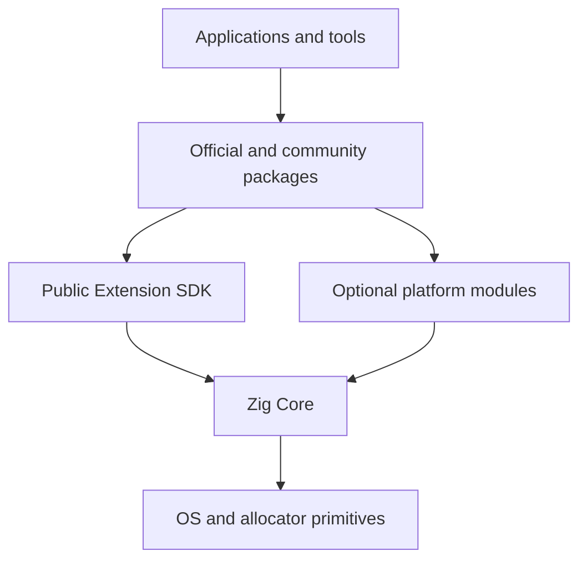
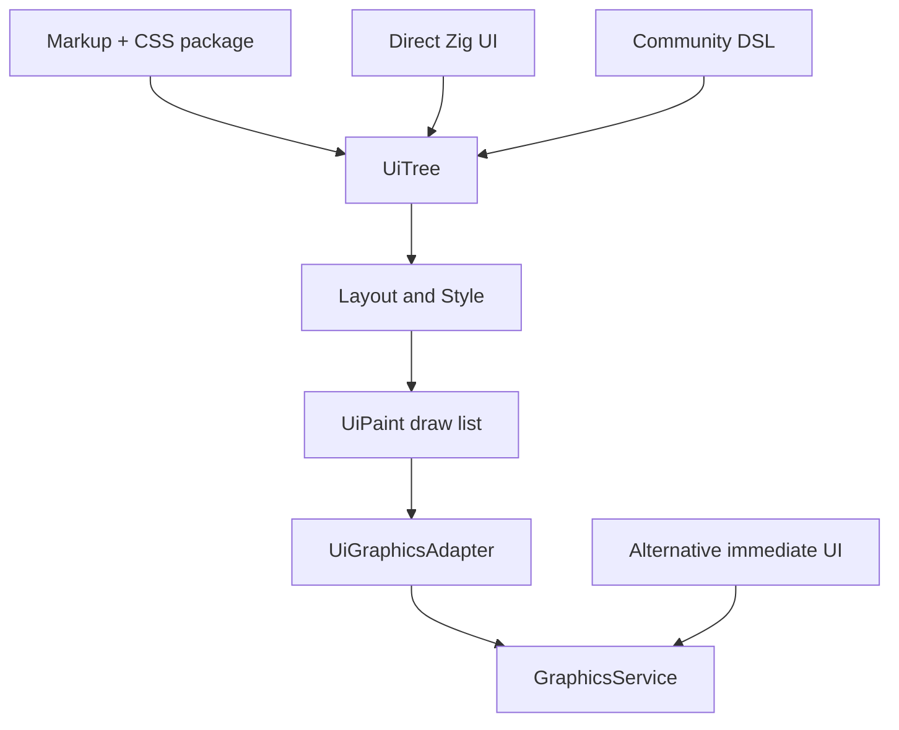
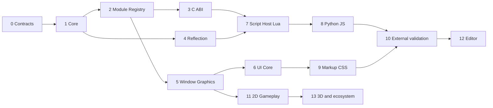

# Modular Zig Engine — Arquitetura, SDK de extensões e roadmap integral

**Estado:** proposta técnica para implementação incremental.  
**Data de referência:** 23/11/2026.  
**Escopo:** engine nova, independente de qualquer engine existente.  
**Linguagem do núcleo:** Zig.  
**Princípio:** core mínimo, capacidades públicas e implementações substituíveis.  
**Fonte de inspiração:** Bevy (composição de plugins), Flecs (ECS), zig-gamedev (bibliotecas), ecossistemas extensíveis.

> **Aviso de exemplos:** APIs chamadas `engine.*`, `App`, `Module`, `UiTree`, `ScriptingHost` e CLI `engine` abaixo são **contratos propostos**, não bibliotecas já implementadas. Os exemplos Zig são especificações de interface e deverão ser compilados e ajustados para a versão travada do toolchain. O header C é um esqueleto de ABI a ser testado em Windows/Linux/macOS. Nenhuma biblioteca de terceiros foi executada neste documento.

---

## 0. Visão do produto

Criar uma engine cuja única base obrigatória seja uma biblioteca Zig contendo ciclo de vida da aplicação, ECS, scheduling, eventos, recursos, registro de serviços, contratos de extensibilidade e mecanismos mínimos de memória. Tudo que se pareça com experiência de usuário — janela, renderer, física, áudio, sistema de scripting, UI e editor — é um módulo opcional.

O autor de uma aplicação poderá:

- escrever todo o jogo em Zig, sem VM;
- instalar oficialmente Python, Lua e/ou JavaScript, simultaneamente ou separadamente;
- criar um runtime de scripting totalmente novo usando o mesmo SDK;
- usar um `ui-core` opcional escrito em Zig com frontend oficial HTML/CSS-like;
- escrever interfaces diretamente em Zig, em Python via binding, ou inventar uma DSL de UI;
- substituir todo o sistema de UI por uma implementação independente que consome janela, input e gráficos;
- criar um editor, console, depurador, model viewer ou engine especializada como coleção de pacotes;
- executar aplicações ECS headless sem dispositivo gráfico.

**Não metas para o MVP:** criar um editor visual completo; browser HTML5; scripting Python em toda entidade; hot-reload seguro de bibliotecas nativas arbitrárias; loja de plugins pública; renderer AAA; paralelismo simultâneo de todos os interpretadores; garantir que todo plugin comunitário seja seguro.

### 0.1 Critérios de sucesso do produto

1. `hello-headless` compila, cria entidade e executa sistemas sem carregar janela, GPU ou runtime externo.
2. `hello-window` abre janela adicionando dois pacotes, sem mudar o core.
3. `python-console` registra um serviço de log e renderiza painel HTML/CSS-like sem tocar o core.
4. `lua-console` implementa o mesmo contrato de comandos sem alterar um único arquivo do core.
5. Um parser comunitário de DSL produz a mesma árvore de UI que o HTML/CSS-like oficial.
6. Uma UI alternativa *não usa* o `ui-core` e ainda assim funciona através de Window/Input/Graphics.
7. Remover um pacote ausente/desativado resulta em erro de dependência legível, não crash.
8. Dois plugins podem disputar um serviço exclusivo e o resolver falha explicitamente, de forma determinística.
9. Uma biblioteca compilada contra o ABI major suportado carrega em versão compatível do host, com testes em C e Zig.
10. O usuário desenvolve em Zig sem saber que as APIs Python, Lua ou JavaScript existem.

### 0.2 Princípios irrenunciáveis

- **Composição sobre herança.** Tudo no App é recurso, entidade, sistema, evento ou serviço, não uma árvore de subclasses mágicas.
- **Dependência unidirecional.** O Core não importa módulos opcionais; módulos opcionais importam o SDK.
- **Contrato antes de implementação.** As capacidades descrevem O QUÊ; o provider define COMO.
- **Simples no caminho feliz, explícito nas bordas.** Wrapper Zig confortável, ABI neutra e rigorosa para plugins externos.
- **Correção antes de hot reload.** Segurança de vida útil e de ownership é inegociável.
- **Pacote não equivale a plugin.** Um pacote pode conter plugins, assets, ferramentas, schemas, configurações e runtimes.
- **Modularidade comprovada por testes externos.** Um pacote de prova não pode ter acesso privilegiado ao repositório do core.

---

## 1. Definições que não devem ser confundidas

| Termo | Significado | Exemplo |
|---|---|---|
| `Package` | Unidade versionada distribuível, com manifest e dependências | `official.script.lua` |
| `Module` | Unidade de configuração de um App, com ciclo de vida | `Physics3DModule` |
| `Service` | Contrato invocável descoberto pelo Registry | `graphics.device/1` |
| `Provider` | Implementação concreta de um serviço | `graphics.webgpu.dawn` |
| `Capability` | Identificador semanticamente versionado da funcionalidade | `ui.documents.markup/1` |
| `Backend` | Implementação substituível de uma interface | backend UI imediata |
| `Scripting Runtime` | Interpretador/VM com interface comum | Python, Lua, QuickJS |
| `Frontend de UI` | Traduz fonte declarativa para uma árvore intermediária | HTML/CSS, JSON, NovaUI |
| `UI Core` | Retained tree, layout, foco, texto, draw list (módulo Zig opcional) | `official.ui.core` |
| `Tool` | Aplicação/painel que usa recursos públicos | inspector, console, editor |
| `World` | Instância de estado ECS | mundo do jogo, mundo de preview |
| `Application` | Composição executável de módulos e recursos | jogo, editor, visualizador |

### 1.1 Divisão de dependências



O desenho não significa que todo módulo opcional precise ser fornecido pelo mesmo projeto. `official.ui.core` pode ser trocado por um pacote da comunidade; `official.render.3d` pode ser removido totalmente.

---

## 2. Núcleo mínimo em Zig: módulos e responsabilidades

### 2.1 `core/app`
- Possui as instâncias `World`, `Scheduler`, `ResourceRegistry`, `ServiceRegistry` e `ModuleGraph`.
- Inicializa módulos em ordem topológica; faz teardown em ordem inversa.
- Suporta run loop próprio e loop delegado por window provider.
- Centraliza estados `Created -> Configured -> Initialized -> Running -> Stopping -> Stopped`.
- Falhas de `initialize()` desfazem os módulos previamente inicializados.

### 2.2 `core/ecs`
- Recomendação inicial: Flecs integrado via `zflecs` atrás de wrapper Zig.
- Entidade usa handle com geração (identidade de runtime; não persistência).
- Componentes estáticos Zig seguem layout declarado; dinâmicos chegam de `TypeRegistry`.
- Queries com `read/write` declarados, invalidadores explícitos e buffers de comando.
- O Core não expõe ponteiros Flecs em API distribuída; em código Zig intra-build pode existir acesso eficiente cuidadosamente controlado.

### 2.3 `core/scheduler`
- Estágios: `startup`, `pre_update`, `fixed_update`, `update`, `post_update`, `render_extract`, `shutdown`.
- Schedules configuráveis. `render_extract` só é ativado se houver provider adequado.
- Declarações `before`, `after`, `run_if`, `reads`, `writes`, `exclusive`.
- Validação de ciclos e conflitos.
- `fixed_update` com acumulador e teto configurável de ticks por frame.
- Nem todo script roda paralelo: sistemas VM são encaminhados ao executor do runtime.

### 2.4 `core/events`
- Eventos tipados Zig e envelope neutral para plugins externos.
- `post()` e `drain()` via filas gerenciadas por host; isolamento por App/World.
- Eventos síncronos só quando não reentrantes e com contrato explícito.
- Subscriptions possuem owner (module/plugin) e são canceladas no unload.
- Bounded queues, estratégia explícita de overflow e métricas `dropped_events`.

### 2.5 `core/resources`
- Resource IDs, acesso com escopo, ownership, borrows e version.
- Resources podem ser globais ao App ou locais ao World.
- Thread affinity opcional (`main`, `render`, `worker`).

### 2.6 `core/commands`
- Operações de ECS durante iterações devem ser enfileiradas.
- `spawn`, `despawn`, `set`, `remove`, `emit`, `invoke_action` com validação de schema.
- Aplicação em pontos determinísticos do scheduler (barreiras).
- Undo/redo não pertence ao Core; plugins podem instrumentar comandos com transações.

### 2.7 `core/reflection`
- Registro de `TypeId`, `FieldDescriptor`, `EnumDescriptor`, defaults, constraints.
- Tipos suportados no MVP: bool, signed/unsigned i32/i64, f32/f64, UTF-8 string, Vec2/3/4, IDs, arrays homogêneos de tamanho dinâmico com ownership, referências de assets.
- `SchemaId = hash(namespace + type + semantic_version)` sem usar apenas nome da classe.
- Schemas têm versão estável e migradores de dados.
- Tipos opacos de Python/JS não são armazenados como structs ECS triviais.

### 2.8 `core/services`
- Registro `ServiceDescriptor` com `id`, `version`, `scope`, `exclusive`, `thread_affinity` e provider.
- `getService(id, version_range)` seleciona provider compatível.
- Erros como `ProviderNotFound`, `VersionMismatch`, `AmbiguousProvider`, `DependencyCycle` são estruturados.
- Resolver acontece na composição inicial; overrides só em pontos seguros.

### 2.9 `core/diagnostics`
- Logs estruturados (timestamp, severity, subsystem, span, thread, fields).
- Métricas acessíveis por serviço (frame time, event backlog, scheduler spans, memory).
- Profiler transport agnóstico: um pacote pode conectar Tracy, ETW, Chrome trace etc.
- Buffer de logs com retenção finita e backpressure.

### 2.10 `core/memory`
- Alocadores por duração: persistent, frame, task/scratch, plugin arena.
- Registrar o owner de toda alocação exposta por serviço público.
- ABI nunca cruza ownership implícito: host allocate/free, ou plugin allocate/free, mas sem mistura.
- Auditoria de memory leak e invalid handles em shutdown/hot reload.

---

## 3. API Zig nativa: proposta de forma

Os métodos abaixo são ilustrativos do contrato desejado; o SDK implementará wrappers sobre estruturas internas estáveis por versão de toolchain.

```zig
const engine = @import("engine");

const Position = struct { x: f32 = 0, y: f32 = 0 };
const Velocity = struct { x: f32 = 0, y: f32 = 0 };

fn movement(ctx: *engine.SystemContext) !void {
    const dt = ctx.fixedDeltaSeconds();
    var query = try ctx.query(.{ .write = .{Position}, .read = .{Velocity} });
    defer query.deinit();

    while (query.next()) |row| {
        const position = row.write(Position);
        const velocity = row.read(Velocity);
        position.x += velocity.x * dt;
        position.y += velocity.y * dt;
    }
}

pub fn main() !void {
    var app = try engine.App.init(.{});
    defer app.deinit();

    try app.registerComponent(Position);
    try app.registerComponent(Velocity);
    try app.addSystem(.{ .stage = .fixed_update, .run = movement });
    try app.run();
}
```

**Nota:** `ctx.query`, `row.write` e `app.addSystem` serão definidos pelo SDK; não são chamadas diretas do `zflecs`. O design final deve preservar o borrow-checking de runtime e não abrir acesso mutável a um mesmo componente para dois sistemas paralelos.

### 3.1 Interface conceitual de módulo Zig

```zig
const ModuleDescriptor = struct {
    id: []const u8,
    version: []const u8,
    required_services: []const []const u8 = &.{},
    optional_services: []const []const u8 = &.{},
};

const Module = struct {
    descriptor: ModuleDescriptor,
    build: *const fn (app: *App) anyerror!void,
    start: ?*const fn (app: *App) anyerror!void = null,
    stop: ?*const fn (app: *App) void = null,
};
```

Módulos nativos estaticamente compilados podem utilizar tipos Zig, `comptime` e APIs de alto nível. **Não** prometer ABI estável para essas estruturas entre versões do compilador; o boundary ABI separado é tratado no capítulo seguinte.

---

## 4. ABI C estável para extensões nativas

### 4.1 Estratégia dual

- **Camada A, Zig-native:** melhor ergonomia e performance para pacotes compilados juntos com o App, sem promessa de compatibilidade binária cross-version.
- **Camada B, C ABI:** fronteira versionada para `.dll`, `.so`, `.dylib`, runtimes embutidos e hosts externos.
- Ambas chegam ao mesmo `ServiceRegistry`, não são dois ECS diferentes.
- Uma UI comunitária pode optar por qualquer uma das duas.

### 4.2 Header inicial (`include/engine_extension.h`)

```c
#ifndef ENGINE_EXTENSION_H
#define ENGINE_EXTENSION_H

#include <stddef.h>
#include <stdint.h>

#ifdef __cplusplus
extern "C" {
#endif

#define AE_ABI_MAJOR 1u
#define AE_ABI_MINOR 0u

typedef uint64_t AEHandle;

typedef enum AEStatus {
    AE_OK = 0,
    AE_ERROR = 1,
    AE_UNSUPPORTED_ABI = 2,
    AE_MISSING_SERVICE = 3,
    AE_INVALID_HANDLE = 4,
    AE_PERMISSION_DENIED = 5,
    AE_BUSY = 6
} AEStatus;

typedef struct AEStringView {
    const char *data;
    size_t length;
} AEStringView;

typedef struct AEHostApi {
    uint32_t struct_size;
    uint32_t abi_major;
    uint32_t abi_minor;
    void *host_context;
    void (*log)(void *host_context, uint32_t level, AEStringView message);
    AEStatus (*get_service)(
        void *host_context,
        AEStringView service_id,
        uint32_t requested_major,
        const void **out_service_api,
        uint32_t *out_api_size
    );
} AEHostApi;

typedef struct AEPluginApi {
    uint32_t struct_size;
    uint32_t abi_major;
    uint32_t abi_minor;
    AEStringView plugin_id;
    AEStatus (*load)(const AEHostApi *host, void **out_state);
    AEStatus (*start)(void *state);
    void (*stop)(void *state);
    void (*unload)(void *state);
} AEPluginApi;

/* Resolve this symbol from the shared library. */
typedef const AEPluginApi *(*AEPluginEntryFn)(void);
const AEPluginApi *ae_plugin_entry(void);

#ifdef __cplusplus
}
#endif

#endif
```

### 4.3 Regras obrigatórias da ABI

1. `struct_size` e `abi_major` são validados antes de qualquer dereference além do prefixo conhecido.
2. `abi_minor` só adiciona campos ao final e sem alterar semântica anterior.
3. `AEStringView` não é NUL-terminated; nunca chamar `strlen` sem garantia separada.
4. Todos os buffers são válidos somente pela duração definida no método, salvo transferência explícita.
5. Funções do host não guardam ponteiros para estado que o plugin pode descarregar.
6. `void *state` pertence ao plugin; só `unload` pode liberá-lo.
7. O host cancela subscriptions/jobs/handles, aguarda callbacks em curso e só então chama `stop -> unload` e descarrega a DLL.
8. Handles incluem geração e domínio/owner: usar um handle antigo retorna `AE_INVALID_HANDLE`.
9. Nenhuma exceção C++, Zig panic ou longjmp cruza o boundary.
10. Serviços retornam pointer + size com lifetime documentado; o consumidor não pode guardar ponteiro além do desligamento do provider.
11. Cada função especifica thread-affinity e se pode reentrar o host.
12. APIs não aceitam ponteiros de heap do outro lado sem função explícita de release.
13. Fluxos assíncronos precisam de IDs de request e resultados em eventos, não callbacks não gerenciados.

### 4.4 Plugin mínimo em Zig: export do entrypoint

```zig
const PluginApi = extern struct {
    struct_size: u32,
    abi_major: u32,
    abi_minor: u32,
    plugin_id: StringView,
    load: *const fn (*const HostApi, *?*anyopaque) callconv(.c) c_int,
    start: *const fn (?*anyopaque) callconv(.c) c_int,
    stop: *const fn (?*anyopaque) callconv(.c) void,
    unload: *const fn (?*anyopaque) callconv(.c) void,
};

const StringView = extern struct {
    data: [*]const u8,
    length: usize,
};

const HostApi = opaque {};

fn load(_: *const HostApi, out_state: *?*anyopaque) callconv(.c) c_int {
    out_state.* = null;
    return 0;
}

fn start(_: ?*anyopaque) callconv(.c) c_int { return 0; }
fn stop(_: ?*anyopaque) callconv(.c) void {}
fn unload(_: ?*anyopaque) callconv(.c) void {}

const api = PluginApi{
    .struct_size = @sizeOf(PluginApi),
    .abi_major = 1,
    .abi_minor = 0,
    .plugin_id = .{ .data = "community.example".ptr, .length = "community.example".len },
    .load = load,
    .start = start,
    .stop = stop,
    .unload = unload,
};

export fn ae_plugin_entry() callconv(.c) *const PluginApi {
    return &api;
}
```

**Observação:** `HostApi` foi reduzida a tipo opaco nesse exemplo para destacar o entrypoint. Na implementação real, espelhar integralmente o header C, validar offsets/tamanhos/alinhamento com teste cruzado e usar códigos de retorno compatíveis (`enum` C não deve ser assumido do mesmo tamanho em todos os compiladores). O projeto pode optar por `int32_t` no header para status a fim de tornar o tamanho inequívoco.

### 4.5 Testes da ABI

- Smoke em C puro e Zig chamando em ambas as direções.
- Teste layout de cada `extern struct` com C `sizeof`, `alignof`, `offsetof`.
- Plugin compilado com versão anterior minor e host novo.
- Plugin com major incompatível -> rejeição sem executar callbacks.
- Plugin com tamanho menor -> host só acessa prefixo conhecido.
- Plugin com serviço ausente, exception interna, timeout e handle invalidado.
- Unload com callbacks simultâneos -> host drena e impede callbacks após unload.
- Uso de allocators diferentes: nenhuma tentativa de `free` cruzado.

---

## 5. Service Registry e Capability Resolution

### 5.1 `Capability` não é apenas um nome

Exemplos de contratos:

- `engine.world/1`
- `engine.scheduler/1`
- `engine.events/1`
- `engine.reflection/1`
- `engine.assets/1`
- `engine.window/1`
- `engine.input/1`
- `engine.graphics.device/1`
- `engine.graphics.render-target/1`
- `engine.script.host/1`
- `engine.script.runtime.python/1`
- `engine.ui.tree/1`
- `engine.ui.frontend.markup/1`
- `engine.ui.surface/1`

O sufixo `/1` é major da interface, não versão do pacote. O registry registra múltiplos provedores e suas implementações. O App resolve `RequiredCapability { id, version_range, scope }` durante a composição.

### 5.2 Política de múltiplos providers

| Capability | Policy recomendada |
|---|---|
| `graphics.device` | single default por App, explicitamente selecionável |
| `window` | single provider por plataforma; várias janelas por instância |
| `physics.world` | múltiplas instâncias por World; escolher provider ao criar |
| `script.runtime.*` | coexistência de vários runtimes |
| `ui.frontend.*` | múltiplos frontends simultâneos |
| `ui.surface` | várias superfícies, potencialmente de backends diferentes |
| `asset.importer` | muitos provedores; seleção por tipo/priority |
| `log.sink` | multicast/fanout |

**Evitar troca silenciosa de provider**: se há ambiguidade, exigir seleção no manifest/app; não escolher simplesmente o primeiro que carregou.

### 5.3 Ciclo de vida do módulo

```text
Discovered -> Resolved -> Loaded -> Registered -> Started -> Running
                                                -> Suspended
Running -> Quiescing -> Stopped -> Unregistered -> Unloaded
```

`Quiescing` bloqueia novas chamadas, cancela subscriptions, espera tarefas ativas, fecha handles externos e só então descarrega código e memória.

### 5.4 Escopos de recursos

- `Process`: runtime de linguagens compartilhado quando permitido.
- `Application`: gráficos, janelas, service registry.
- `World`: ECS, sistemas, recursos e cenas.
- `Window`: input, foco e superfícies.
- `Plugin`: storage/assinaturas/instâncias isoladas.
- `Frame`: buffers descartáveis.

Callbacks de um plugin não podem acessar `World` ou `Window` já destruídos.

---

## 6. ECS, scheduler e cross-language data model

### 6.1 Adotar Flecs sem expor Flecs como contrato público

Começar com `zflecs` para não gastar os primeiros marcos desenvolvendo um ECS complexo. O componente pode ser registrado em runtime via APIs Flecs C e associado a metadados de reflexão. A API pública do projeto, porém, deve referenciar `EntityId`, `ComponentTypeId`, `WorldId`, `QueryHandle` e `CommandBuffer` próprios.

### 6.2 Identidades e validade

- `EntityHandle`: uint64 index+generation dentro do World; nunca persistir o handle bruto na cena.
- `EntityGuid`: 128 bits para serialization/undo/asset references.
- `TypeId`: ID interno resolvido de namespace + nome + schema major, com validação de colisão.
- `WorldId`: geração para impedir acessar World destruído.
- `PluginId`: identidade estável de package + módulo.

### 6.3 ComponentSchema

```json
{
  "namespace": "sample.gameplay",
  "name": "Health",
  "version": 1,
  "storage": "blittable",
  "fields": [
    { "name": "current", "type": "f32", "default": 100.0 },
    { "name": "maximum", "type": "f32", "default": 100.0 }
  ]
}
```

Esse JSON é um formato de exemplo; o registro final pode usar schema binário para evitar parsing no hot path.

Três políticas de storage:

1. `blittable`: memória contínua nativa, layout conhecido, ideal para ECS.
2. `managed_handle`: ECS armazena ID de um objeto no runtime proprietário, com validação de lifetime.
3. `blob`: dados serializados/opacos; acesso menos eficiente, não deve ser hot path.

### 6.4 Scheduler: conflitos e segurança

- Cada sistema declara `reads`, `writes`, `run_after`, `run_before`, `thread_affinity`, `runtime_owner`.
- Zig-native poderá executar em paralelo se não houver conflito e se subsistemas forem thread-safe.
- Python no MVP usa executor serial por App, com thread-state corretamente gerenciado.
- Lua um state não pode ser usado simultaneamente sem protocolo de sincronização; dar ownership a thread definida.
- QuickJS runtime é single-thread-affine, callbacks na thread dona do VM.
- `applyCommands()` após estágio; alterações estruturais não ocorrem durante query aberta.
- Componentes dinâmicos registram layout e operações `copy/move/destruct`; não copiar object handles cegamente.

### 6.5 Mensagens entre linguagens

Criar tipos FFI e serialização que não dependam de objetos Python/JS:

```json
{
  "event": "game.damage_received",
  "world": "main",
  "entity": "guid:...",
  "payload": {
    "amount": 12.5,
    "source": "guid:..."
  }
}
```

No runtime, preferir envelope binário e schema registrado. JSON é ferramenta de depuração e troca offline, não transporte padrão entre sistemas por frame.

---

## 7. Scripting Host Protocol (SHP)

### 7.1 Filosofia

O Core não contém classes especiais `PythonSystem`, `LuaComponent` ou `JavaScriptEvent`. O módulo `scripting-host`, opcional, expõe `engine.script.host/1` e gerencia providers de runtime.

### 7.2 Contrato comum

```text
RuntimeProvider:
    identity() -> RuntimeDescriptor
    create(config, allocator, host_api) -> RuntimeHandle
    register_bindings(runtime, engine_api) -> Result
    load(runtime, module_path) -> ScriptModuleHandle
    invoke(runtime, callback_handle, arguments) -> ScriptResult
    poll(runtime, budget) -> ScriptResult
    unload(runtime, module_handle) -> Result
    destroy(runtime) -> Result

RuntimeDescriptor:
    language_id
    language_version
    api_version
    extensions
    supports_hot_reload
    supports_async
    supports_debugger
    thread_affinity
    permissions
```

**Não exigir mesmo modelo de classes e decoradores em todas as linguagens.** O SHP padroniza serviços, mensagens, handles e callbacks; cada binding pode ser idiomático na linguagem que serve.

### 7.3 Regras de threading e ownership

- Cada instância de runtime tem owner module e executor.
- O host nunca chama VM através de thread que não respeite seu contrato.
- Chamadas engine->script retornam status + erro estruturado + traceback/log.
- Script não guarda ponteiro ECS nativo; usa entity handle e API de acesso em lote.
- `ScriptModuleHandle` invalida ao reload; subscriptions são vinculadas à geração.
- Exceção de um script não pode ultrapassar o FFI nem finalizar o processo.
- Script arbitrário **não é sandbox**. Segurança exige processo isolado ou runtime restringido/empacotado.

### 7.4 Python oficial

Stack: CPython incorporado via C API por camada Zig, com API pública Python `engine` fornecida por extensão nativa.

MVP:
- Inicialização única CPython por processo; cada projeto usa namespace e module loader próprios.
- Executor único serial, até que arquitetura de subinterpreters seja devidamente validada.
- Gerenciamento de referências explícito nas bindings; nunca manter `PyObject*` após teardown do runtime.
- `PythonPlugin` adiciona runtime, tipos de script e roteamento de erros.
- Imports externos configuráveis por projeto, isolamento de `sys.path`, venv/packaging definido separadamente.

```python
from engine import App, system, Stage

@system(stage=Stage.UPDATE, reads=["game.Velocity"], writes=["game.Position"])
def move_entities(ctx, dt: float):
    for entity, position, velocity in ctx.query("game.Position", "game.Velocity"):
        position.x += velocity.x * dt
        position.y += velocity.y * dt


def configure(app: App):
    app.systems.register(move_entities)
    app.events.subscribe("app.started", lambda event: print("Started"))
```

O loop acima é excelente para prototipagem, mas ainda cruza runtime por entidade. Uma API `ctx.query_columns(...)` para arrays contíguos e `ctx.commands.bulk_update(...)` é necessária para performance.

### 7.5 Lua oficial

Usar Lua 5.5 com C API e estados por aplicação ou por plugin (decisão a ser benchmarkada; escolher inicialmente um state por App, com namespaces próprios). Um state não é mecanismo de isolamento contra código não confiável.

```lua
local engine = require("engine")

local plugin = {}

function plugin.register(app)
    app:on("app.started", function(event)
        engine.log.info("Started from Lua")
    end)
end

return plugin
```

### 7.6 JavaScript oficial

Utilizar QuickJS-NG (ou QuickJS, após avaliação de licença, atualização e API), encapsulando `JSRuntime`/`JSContext` e resolvendo jobs/microtasks pelo scheduler. Time/memory budget exige instrumentação e chamadas apropriadas de interrupt, mas não é sandbox forte.

```javascript
import { events, log } from "@engine/core";

export function register(app) {
  app.events.on("app.started", () => {
    log.info("Started from JavaScript");
  });
}
```

### 7.7 API transversal

Em cada linguagem oferecer equivalentes de:

- `Entity`: `spawn`, `despawn`, `has`, `get`, `set`, `remove`.
- `World`: `query`, `resource`, `commands`.
- `Events`: `publish`, `subscribe`, `unsubscribe`.
- `App`: `registerSystem`, `registerComponent`, `registerModule`.
- `Services`: `get`, `has`, `call`, com capability/version.
- `Assets`: `loadAsync`, `resolve`, `watch`.
- `UI`: disponível somente se um provider estiver instalado.

### 7.8 Teste indispensável: coexistência

Python publica `game.damage`; Lua recebe e aplica alteração via `Commands`; JavaScript observa o evento e envia log; Zig consulta o componente atualizado no próximo ponto de sincronização. **Sem nenhum branch da lógica no Core baseado no tipo de linguagem.**

---

## 8. UI Core em Zig: independente da sintaxe e do renderer

### 8.1 Por que separar?

Uma árvore visual possui responsabilidades diferentes de um parser HTML. Se o parser de HTML for o núcleo, a comunidade será obrigada a seguir esse modelo. Se o `UiTree` for o núcleo opcional, HTML/CSS torna-se uma maneira de alimentar a mesma representação.

### 8.2 Pacotes sugeridos

- `official.ui.core` — retained tree, nós, layout, estilos resolvidos, eventos, foco e a11y.
- `official.ui.text` — font manager, shaping, line break, glyph atlas, seleção e IME.
- `official.ui.paint` — draw list: texto, imagens, formas, clipping, transforms.
- `official.ui.renderer` — adapter draw list -> GraphicsService.
- `official.ui.widgets` — button, textbox, list, tree, dropdown, slider, virtual list.
- `official.ui.markup` — parser HTML-like + conversor para `UiTree`.
- `official.ui.styles.css` — parser CSS-like, cascade, selectors e computed styles.
- `official.ui.docking` — panes, tabs, splittable layouts, persistência.
- `official.ui.python` / `.lua` / `.js` — bindings **opcionais**.

No MVP, `ui.core` pode incluir render commands e layout básico em um pacote só; dividir componentes quando surgir necessidade real de substituição. Evitar desenhar 9 contratos antes de existir um botão clicável.

### 8.3 Modelo de renderização



**Regra de ouro:** providers alternativos de UI podem pular integralmente a árvore. Apenas funcionalidades que dependem de `ui.tree/1` exigirão esse provider; ferramentas podem expressar requisitos explicitamente.

### 8.4 Modelo intermediário de UI

```json
{
  "type": "panel",
  "id": "developer.console",
  "properties": { "title": "Developer Console", "dock": "bottom" },
  "children": [
    { "type": "label", "id": "caption", "properties": { "text": "Console" } },
    { "type": "list", "id": "messages", "properties": { "virtualized": true } },
    { "type": "textbox", "id": "command", "properties": { "placeholder": "Enter command" } }
  ]
}
```

Esse IR define identidade, hierarquia e propriedades. Não expõe parsers nem strings HTML internas. Nós também possuem propriedade `semantics`, roles e ligação com ações públicas.

### 8.5 API direta Zig (proposta)

```zig
fn buildConsole(ui: *UiContext) !void {
    const panel = try ui.createPanel(.{
        .id = "developer.console",
        .title = "Console",
    });
    try panel.addLabel(.{ .text = "Developer Console" });
    try panel.addVirtualList(.{ .id = "messages" });
    try panel.addTextInput(.{ .id = "command" });
    try panel.bindAction("command", "submit", "debug.execute");
}
```

### 8.6 Frontend oficial HTML/CSS-like

O oficial pode usar sintaxe própria limitada e **documentada**, sem prometer que renderiza qualquer site da internet.

```html
<ui-document>
  <panel id="developer.console" title="Console" dock="bottom">
    <header class="toolbar">
      <label>Developer Console</label>
      <button action="debug.clear">Clear</button>
    </header>
    <virtual-list id="messages" items="state.logs" />
    <text-input id="command" on-submit="debug.execute" />
  </panel>
</ui-document>
```

```css
#developer.console {
    width: 100%;
    min-height: 240px;
    background-color: #151922;
    color: #e4e8ef;
    display: flex;
    flex-direction: column;
}

.toolbar {
    display: flex;
    justify-content: space-between;
    padding: 8px 12px;
}

#messages {
    flex-grow: 1;
    overflow-y: auto;
}
```

Obs.: `virtual-list`, `on-submit` e `action` são extensões propostas; não afirmar que são sintaxe nativa do HTML ou do RmlUi.

### 8.7 Linguagem alternativa da comunidade: `NovaUI`

```text
Panel "Console" as developer.console {
    dock: bottom
    minHeight: 240

    Label "Developer Console"
    VirtualList id=messages items=state.logs
    TextInput id=command onSubmit=debug.execute
}
```

O package `community.novaui` registra `ui.frontend.novaui/1`, implementa seu parser e devolve `UiDocument IR` validado. A engine não ganha qualquer `if language == "novaui"`.

### 8.8 Backend alternativo sem UI Core

Um pacote pode registrar `ui.backend.immediate/1` e consumir apenas `window`, `input` e `graphics`. Ele não precisa converter nada para UiTree. Ferramentas que exigem interfaces diferentes devem trabalhar com `ToolSurface`/`PanelHost` (capabilities) e descobrir dinamicamente se existe provider apropriado, não assumir DOM.

### 8.9 DOM vs UiTree: evita promessas falsas

- Um frontend HTML-like pode expor um DOM próprio, mas o Core de UI não deve depender dele.
- CSS parser é substituível; computed styles usam valores internos padronizados.
- Layout pode ser engine própria ou Yoga/taffy-like via bridge, desde que a API do `UiLayout` seja estável.
- Texto Unicode complexo precisa shaping (HarfBuzz ou alternativa), font fallback, IME, RTL, acessibilidade.
- DOM diff e update incremental devem evitar reconstruir toda árvore a cada frame.
- Render cache e subtree invalidation devem ser instrumentados desde o início.
- Layout, painter, input e DOM não devem ser misturados em um único arquivo/módulo.

### 8.10 Testes de UI

1. A mesma IR construída por Zig, HTML/CSS e NovaUI produz árvore equivalente.
2. O mesmo layout renderiza em pelo menos dois tamanhos e DPI.
3. Foco por teclado, edição IME, click, scroll, clipping e hit testing.
4. 1000 logs em virtual list sem 1000 widgets permanentes.
5. Reload de CSS preserva cursor e seleção de texto.
6. Reload de documento cancela os handlers antigos.
7. UI sobre render texture funciona sem editar o renderer.
8. Backend de UI alternativo instala e roda sem `official.ui.core`.

---

## 9. Packages, manifest e CLI

### 9.1 Package manifest (`engine.package.toml`) — proposta

```toml
[package]
id = "official.script.python"
version = "0.1.0"
kind = "native-module"
license = "MIT"

[compatibility]
engine_api = "^0.1"
abi_major = 1

[dependencies]
"official.script.host" = "^0.1"

[provides]
capabilities = ["engine.script.runtime.python/1"]

[permissions]
filesystem = "project"
network = false

[platform]
os = ["windows", "linux", "macos"]
arch = ["x86_64", "aarch64"]
```

**Importante:** as permissions são requisitos declarativos, **não** impedem um plugin nativo malicioso de acessar filesystem/rede. Permissões são efetivas apenas em processos sandboxed/WASM/OS sandbox ou quando o host consegue impor limites de verdade.

### 9.2 Manifest de projeto

```toml
[project]
name = "sandbox-tools"
version = "0.1.0"
entry = "src/main.zig"

[packages]
"official.window" = "^0.1"
"official.graphics" = "^0.1"
"official.ui.core" = "^0.1"
"official.ui.markup" = "^0.1"
"official.script.python" = "^0.1"
"community.console" = "^0.2"

[providers]
"engine.graphics.device/1" = "official.graphics.webgpu"
"engine.ui.frontend.markup/1" = "official.ui.markup"
```

### 9.3 CLI desejado

```bash
engine init my-app --template=headless
engine add official.window
engine add official.ui.core
engine add official.ui.markup
engine add official.script.python
engine add community.console
engine doctor
engine packages graph
engine run
engine test
engine package --target=windows-x86_64
```

O CLI é uma camada ergonômica; o build Zig segue como fonte de verdade para resolução binária. `build.zig.zon` é coordenado pelo gerenciador, evitando um segundo grafo de dependências divergente.

### 9.4 Lockfile e supply chain

- Lock com URL de origem, commit/ref, checksums e transitive dependencies.
- Reprodutibilidade offline para builds CI e releases.
- Manifest assinado (mais tarde); hash obrigatório desde MVP.
- Revogar pacotes comprometidos e indicar aviso no registry.
- Git URL permitido mediante confiança do usuário, não autoload invisível.
- Resolved graph, versões ABI e seleção de providers registrados no artefato.
- Licenças transitivas auditadas antes de distribuição.

### 9.5 Política de distribuição de pacote

`source`: compila com a aplicação, ideal para Zig-native.  
`native-binary`: traz artefatos precompilados com ABI C por target.  
`script`: roda em runtime instalado e declara dependência explícita.  
`asset`: dados não executáveis, ainda requer validação de formato e limites.  
`tool`: composto por outros pacotes e recursos.

---

## 10. Editor, ferramentas e exemplos reais

### 10.1 Console em Python, UI markup (pacote de comunidade)

Layout:

```text
community.console/
├── engine.package.toml
├── plugin.py
└── ui/
    ├── console.ui.html
    └── console.ui.css
```

Plugin:

```python
from engine import Plugin

class ConsolePlugin(Plugin):
    def register(self, app):
        app.actions.register("debug.clear", self.clear)
        app.actions.register("debug.execute", self.execute)
        app.panels.register(
            panel_id="developer.console",
            document="ui/console.ui.html",
            stylesheet="ui/console.ui.css",
            open_on_start=True,
        )
        app.events.subscribe("log.record", self.on_log, owner=self)

    def on_log(self, record):
        self.app.ui.models.append("state.logs", record)

    def execute(self, event):
        self.app.commands.execute(event.text)

    def clear(self, event):
        self.app.ui.models.clear("state.logs")

    def unload(self):
        # The host also revokes all registrations owned by this plugin.
        pass
```

A API `Plugin`, `actions`, `panels` e `models` é uma camada opcional construída pelo pacote de Python e pelo host de UI; o Core Zig não precisa ter essas classes.

### 10.2 Editor em Zig sem Python

`official.tools.editor-shell` instala `window`, `input`, `graphics`, `ui.core`, `ui.docking`, `scene`, `assets`. O App monta hierarchy, inspector, content browser e viewport. Nada de `script.python` é requerido.

### 10.3 Inspector community-powered

Com `ReflectionService`:

1. Obter tipo de cada componente da entidade selecionada.
2. Ler `FieldDescriptor` e constraints.
3. Resolver widget apropriado (`f32` -> slider, color -> color picker).
4. Enviar `SetComponentField` via `Commands` com validação.
5. Salvar operação em `UndoHistory` oferecida por pacote específico.
6. Indicar erro se tipo/provider não tiver codec ou UI widget.

### 10.4 Editor sem UiTree

Uma aplicação instala somente `window`, `graphics`, `ui.immediate`, `tools.command-palette` e um renderer 3D. O editor de cena usa Dear ImGui ou backend comunitário, sem o `ui.core`. Se for necessário coexistir com UI markup, ambas desenham via `GraphicsService` em passes declarados e compartilham o `InputService` com política de foco explícita.

---

## 11. Sistema de assets e formatos comunitários

`AssetService` é módulo opcional, mas essencial para ecossistema de jogos.

- `AssetId`, URI (`project://`, `engine://`, `package://`), hash e versão.
- Importer descriptors: extensões, MIME, prioridade, custo, capacidade (`streaming`, `headless`, `gpu-required`).
- Loaders geram `AssetHandle` não ponteiro bruto.
- Cache por conteúdo e dependências transversais.
- Hot reload em tarefa assíncrona; troca de recurso em ponto seguro.
- Um plugin pode registrar import de `.svg`, `.glb`, `.rml`, `.novaui`, `.wasm` sem alterar o Core.
- Não executar arquivo de asset como script automaticamente.
- Nenhum asset pode guardar referência a callback de plugin descarregado.

### 11.1 Exemplo de importer

```zig
const ImporterDescriptor = struct {
    id: []const u8,
    extensions: []const []const u8,
    priority: u32,
    import: *const fn (ctx: *ImportContext, source: []const u8) anyerror!AssetArtifact,
};

const png_importer = ImporterDescriptor{
    .id = "official.texture.png",
    .extensions = &.{".png"},
    .priority = 100,
    .import = decodePng,
};
```

Novamente, API ilustrativa. Em plugins dinâmicos, codec precisará usar ABI compatível e retorno por handles, não `anyerror!AssetArtifact` cruzando fronteira.

---

## 12. Window, Graphics e Renderer como serviços independentes

**Não** colocar GPU no Core.

1. `WindowService`: janelas, DPI, tamanho, input raw, lifecycle.
2. `GraphicsDeviceService`: buffers, textures, command encoders, synchronization, capabilities.
3. `RenderGraphService`: scheduling e dependências de passes (módulo opcional).
4. `Renderer2D`: sprites, cameras, draw batching.
5. `Renderer3D`: meshes, depth, materiais, lighting (depois).
6. `UiGraphicsAdapter`: traduz draw lists de UI para passes.

Avaliar `zgpu`/Dawn inicialmente por portabilidade, mas o SDK deve evitar retornar diretamente `wgpu` handles específicos. Uma engine comunitária pode oferecer backend gráfico distinto sem alterar `App`, `World` ou `UiTree`.

### 12.1 Contrato de renderização para ferramentas

`PanelSurface` tem tamanho, DPI, input region e `RenderTargetHandle`. O viewport de editor pode mostrar uma câmera 3D por textura e o console desenhar sobre a janela. Não misturar render target com documento markup.

### 12.2 Resolução de capacidades gráficas

- Provider declara features (`compute`, `depth_texture_sampling`, `storage_buffers`, `timestamp_queries`).
- Pacote que exige compute valida a capability antes de startup.
- Exibir diagnóstico para fallback quando feature ausente.
- UI e gameplay não precisam saber se o device é WebGPU, OpenGL ou backend proprietário.

---

## 13. Hot reload, observabilidade e fault containment

### 13.1 Matrix de reload no MVP

| Tipo | Reload automático? | Condição |
|---|---|---|
| `.css`/styles | Sim | Reparse e invalidação incremental |
| HTML-like document | Sim | Reconcile com IDs estáveis, preservar estado recuperável |
| Python/Lua/JS | Sim, opt-in | Quiesce callbacks, snapshot serializável, restart VM/module |
| Asset | Sim | Swap de handle após import bem-sucedido |
| Schema ECS | Não irrestrito | Migração explícita de layout e versão |
| Zig-native estático | Não | Rebuild |
| Native DLL | Experimental após MVP | ABI stable, idle jobs, no borrow, no remaining references |

### 13.2 Política de atualização

1. Detectar mudança com debounce.
2. Validar novo código/documento sem alterar estado ativo, se viável.
3. Quiesce provider e seus callbacks.
4. Fazer snapshot só de estado declarado persistível.
5. Desregistrar actions/subscriptions/jobs/handles do owner.
6. Inicializar nova versão e realizar restore/migrations.
7. Commit da troca em fronteira do frame; no erro, manter anterior ou desabilitar pacote conforme política.
8. Registrar evento estruturado `package.reload.failed` ou `package.reload.succeeded`.

### 13.3 Ferramentas de diagnóstico

- `engine doctor`: versões ABI, Graph, permissões, pacotes sem provider.
- `engine packages graph`: grafo e motivo de escolha de cada provider.
- `engine trace`: eventos, CPU spans, backlog de VM e chamadas FFI.
- `engine ui inspect`: árvore visual, styles resolvidos e layout inválido, se provider suportar.
- `engine scripts list`: runtimes instalados, modules, erros e budgets.

---

## 14. Segurança e confiança

**Pacote nativo tem autoridade do processo.** Manifesto de permissões não é sandbox. Os três regimes devem ser distintos:

1. **Trusted native:** Zig/C/C++/Rust dentro do processo, máximo desempenho, confiança total.
2. **Trusted interpreted:** CPython/Lua/QuickJS no mesmo processo, ainda pode acessar recursos além do host se bibliotecas permitirem.
3. **Restricted external:** processo separado com RPC ou WASM com imports explicitamente permitidos, limites e isolamento — fase posterior.

- Assinatura e reputação são controles de procedência, não execução segura.
- QuickJS memory/interrupt limits ajudam com runaway code, mas não substituem sandbox.
- Scripts Python que importam bibliotecas nativas deixam de ter isolamento de memória confiável.
- APIs devem validar limites de buffers, nomes, caminho, volumes de eventos e payload.
- Debug consoles que executam comandos são desativados por padrão em builds distribuidos, salvo permissão explícita.
- O Registry deve ter revisão de pacote, licença, checksums e mecanismo de alerta de versões comprometidas.

---

## 15. Benchmarks e requisitos não funcionais

### 15.1 Baselines por cenário

- Headless ECS: 1k / 10k / 100k entidades; spawn/despawn, query, serialização.
- Scheduler: 8 / 100 / 1000 systems, conflito e parallel speedup.
- FFI: 1k / 100k / 1M chamadas vazias; chamadas em batch, payload 16 B / 4 KiB / 1 MiB.
- Scripting: callbacks por frame, 100/1000/10000 entidades, 3 runtimes simultâneos.
- UI: 100/1000/10000 nodes, layout cold/warm, invalidation, virtual list 100k logs.
- Packages: startup com 0/10/100 pacotes, resolução cold/warm.
- Hot reload: tempo de quiesce, custo de rebuild, vazamentos e subscriptions órfãs.
- Graphics: draw list 100/10000 draw calls, upload, device-lost recovery.

### 15.2 Metas iniciais (hipóteses, não garantias)

- Inicialização headless sem importar UI/render/script.
- Nenhuma alocação persistente por frame para percurso ECS já aquecido em caminho crítico.
- Sem cruzamento FFI por elemento em pipelines intensivos; batch disponível.
- Latência do hot reload UI medida em p50/p95 e sem perda de handlers/handles.
- Overhead de `get_service` amortizado: resolver e guardar handle versionado, não fazer string lookup por pixel/partícula.
- UI virtualizada é obrigatória para listas grandes.
- Nenhum custo de runtime desativado: se Python não está instalado, nenhum CPython é inicializado.
- CI com testes funcional, sanitizers nas dependências onde suportado, fuzz para parsing e crash tests.

### 15.3 Benchmark imparcial

Comparar C/Zig/Rust/Python apenas quando mesma semântica, mesmo volume, mesmo algoritmo, mesmas flags e sem otimização artificial. Para sistemas de script, medir tempo do caso real incluindo bridge e cópias; reportar p50, p95, throughput, alocações e regressões. Benchmark isolado não autoriza reescrita do Core.

---

## 16. Estrutura inicial do repositório

```text
modular-zig-engine/
├── build.zig
├── build.zig.zon
├── README.md
├── LICENSE
├── docs/
│   ├── architecture/
│   ├── contracts/
│   ├── adr/
│   ├── api/
│   └── tutorials/
├── include/
│   └── engine_extension.h
├── src/
│   ├── main.zig
│   └── core/
│       ├── app.zig
│       ├── world.zig
│       ├── scheduler.zig
│       ├── commands.zig
│       ├── events.zig
│       ├── resources.zig
│       ├── service_registry.zig
│       ├── module_registry.zig
│       ├── reflection.zig
│       └── diagnostics.zig
├── sdk/
│   ├── zig/
│   ├── abi/
│   └── generated/
├── packages/
│   ├── window/
│   ├── graphics/
│   ├── scripting-host/
│   ├── ui-core/
│   └── assets/
├── examples/
│   ├── headless-ecs/
│   ├── window-only/
│   ├── python-console/
│   ├── lua-console/
│   ├── mixed-runtimes/
│   ├── markup-ui/
│   ├── community-dsl/
│   ├── custom-ui-backend/
│   └── minimal-editor/
├── tools/
│   ├── cli/
│   ├── schema-codegen/
│   └── abi-check/
├── tests/
│   ├── unit/
│   ├── integration/
│   ├── compatibility/
│   ├── fuzz/
│   └── performance/
└── .github/
    └── workflows/
```

### 16.1 Estratégia de GitHub

**MVP:** monorepo para manter contratos e exemplos sincronizados.  
**Após estabilizar SDK:** `engine` e `engine-official-packages`; repositórios separados para documentação, templates e registry quando houver usuários/pacotes reais.  
**Publicação comunitária:** Git repos próprios, lockfile de hashes, index no registry, política de dependências e revisão opcional.

---

## 17. Roadmap executável (fases 0–13)

Cada fase deve terminar com artefatos, testes e decisão de avanço. Fases possuem dependências explícitas. Nenhuma estimativa temporal é prometida.

### Fase 0 — Contratos e ADRs

**Entregar:** visão, não metas, matriz de competências, ADRs de identidade/ABI/plugins/ECS/ownership, convenções de nome, suporte de plataforma, Zig e dependências travadas.  
**Testar:** construir CI mínima Zig ReleaseSafe e Debug, lint/docs, validar `build.zig.zon`.  
**Gate:** nenhuma API de provider tem dependência de uma VM ou renderer concreto.

### Fase 1 — Core headless

**Entregar:** `App`, `World`, scheduler serial, recursos, events, commands, basic diagnostics; Flecs integrado atrás de facade.  
**Demonstrar:** 1000 entidades, sistema de movimento, eventos e shutdown.  
**Gate:** `zig build test` e `headless-ecs` sem janela/GPU/Python.

### Fase 2 — Service Registry e módulos Zig

**Entregar:** registro de módulos, resolver capacidades, ciclos, conflitos, escopos, lifecycle.  
**Demonstrar:** um provider de log dummy e dois consumidores, ordem topológica independente da lista de inserção.  
**Gate:** unload reverso, rollback de init, nenhum serviço dangling.

### Fase 3 — Extension SDK + C ABI

**Entregar:** `engine_extension.h`, loader nativo, contracts versionados, handle generation, ABI validation.  
**Demonstrar:** plugin C mínimo carregado por host Zig, mesmo plugin recompilado separadamente.  
**Gate:** suite `abi-compat` cross-compiler, erro major mismatch e unload sem callbacks tardios.

### Fase 4 — Reflection e schemas dinâmicos

**Entregar:** `TypeRegistry`, `ComponentSchema`, codecs, queries por tipo dinâmico, `get_field/set_field`, migrations.  
**Demonstrar:** registrar `Health` a partir de JSON e persistir/restaurar componente.  
**Gate:** novos schemas sem recompilar host, layout invalidado corretamente.

### Fase 5 — Window/Input/Graphics mínimo

**Entregar:** providers `window`, `input`, `graphics`, uma surface e draw command com present.  
**Demonstrar:** janela com clear, resize, input e loop, opcional ausência total em headless.  
**Gate:** testes de vida útil resize/close e error reporting de dispositivo indisponível.

### Fase 6 — UI Core Zig

**Entregar:** UiTree, layout flex básico, paint list, UI input, foco, texto mínimo, um Button e Label.  
**Demonstrar:** painel direto em Zig que desenha logs e reage a click.  
**Gate:** 1000 nodes, hit test consistente, nenhuma dependência de HTML ou script.

### Fase 7 — Scripting Host + Lua (primeira integração de prova)

**Entregar:** SHP, VM executor, `world/events/services` por handles, Lua bridge, erros isolados.  
**Demonstrar:** Lua instala um sistema e responde evento; arquivo hot reload sem callback duplo.  
**Gate:** Core não referencia `Lua`; casos de reload/leak e erros de scripts passam.

**Por que Lua primeiro?** API C pequena e caminho de integração direto; use esse milestone para encontrar problemas no contrato antes do runtime Python mais complexo. É uma escolha de ordem, não hierarquia de importância entre linguagens.

### Fase 8 — Python e JavaScript

**Entregar:** CPython e QuickJS(-NG), language-specific bindings, docs e coexistência.  
**Demonstrar:** mesma aplicação com os três runtimes publicando/recebendo eventos e acessando schemas.  
**Gate:** nenhum `if Python/Lua/JavaScript` no Core; cross-language test e tooling de exceção.

### Fase 9 — Markup/CSS-like oficial

**Entregar:** frontend parser, style resolver, ações, DOM adapter opcional, hot reload.  
**Demonstrar:** console markup equivalente ao console Zig; CSS reload com foco preservado.  
**Gate:** sintaxe documentada e testes de compatibilidade de árvore/style sem browser.

### Fase 10 — Extensibilidade validada pela comunidade

**Entregar:** template `language-runtime`, `ui-frontend`, `ui-backend`; ADR externa independente.  
**Demonstrar:** runtime de brinquedo ou Lua externo, NovaUI DSL, backend UI independente, sem patch no Core.  
**Gate fundamental:** nenhum arquivo em `src/core` alterado durante os três experimentos. Se falhar, refatorar SDK antes de lançar novos módulos.

### Fase 11 — Assets, scenes e pacote de jogo 2D

**Entregar:** AssetService, Scenes, transform graph, sprite renderer, input mapping, game loop e empacotamento.  
**Demonstrar:** jogo 2D simples escrito em Zig, Lua e/ou Python.  
**Gate:** cold start sem importar editor, assets cache e scene restore.

### Fase 12 — Ferramentas modulares e editor opcional

**Entregar:** panel registry, docking, console, hierarchy, inspector, viewport, command history (em pacotes).  
**Demonstrar:** mini editor feito com Python+markup e outro feito diretamente em Zig.  
**Gate:** editor não é dependência reversa do Core nem do jogo exportado.

### Fase 13 — Engine 3D, CI multiplataforma e ecossistema

**Entregar:** renderer 3D, física, áudio, mesh, animação progressiva, packaging multiplataforma, registry, docs e benchmark.  
**Demonstrar:** sandbox 3D + aplicativo independente do editor.  
**Gate:** testes release/compatibilidade, licenças, performance, portal de docs e versionamento público.

### 17.1 Dependências críticas



### 17.2 Critério de aprovação de cada PR

- Compila na versão de Zig pinada.
- Testes unitários, integração e ABI aplicáveis passam.
- API nova tem exemplos Zig e, quando for contrato transversal, exemplo de pelo menos outra linguagem.
- Não adiciona dependências de módulos concretos ao Core.
- Declara ownership, thread-affinity e lifecycle.
- Não quebra ABI minor e documenta schema/version change.
- Registro de eventos/serviços cancelado com teardown.
- Benchmark anexado quando modifica hot path.
- CI valida projeto sem Python/UI/graphics.
- Documentação e changelog apontam se o recurso é opcional.

---

## 18. Planos de testes por contrato

### 18.1 `ModuleRegistry`

- Geração topológica correta, inclusive dependências opcionais.
- Detecta ciclos e requer provider explícito em ambiguidades.
- Two-worlds isolation; destruir `World A` não invalida `World B`.
- Cancelamento de jobs/sources quando plugin para.
- Fault injection em cada etapa de init e rollback completo.

### 18.2 `ScriptingHost`

- Python, Lua, JS retornam mesmos tipos básicos pela bridge.
- Event callback desencadeia comando e só altera ECS em barreira segura.
- Runtime desligado rejeita handles e não entrega callbacks.
- Script que entra em loop infinito é detectado/abortado quando runtime suporta interrupts; isolamento forte exige processo separado.
- Testar timeouts, erros de encoding, caracteres Unicode e falha na importação.
- Benchmark `batch vs per-entity` com ganho/overhead documentados.

### 18.3 `UiCore`

- Golden tests de layout e render usando draw list determinística.
- Input, hover, click, drag, text focus, IME e scroll.
- 100k logs virtualizados (somente widgets visíveis materializados).
- Reload documento e stylesheet com estado preservado quando IDs persistem.
- Prova `NovaUI` converte para mesmo IR.
- Backend alternativo prova independência real.

### 18.4 Segurança e conformidade

- Fuzz em parsers markup/CSS/DSL e manifests.
- Verificação de overflow de tamanhos/pointers/encoding e transitividade.
- Testar plugins com paths inválidos e checksum incorreto.
- Documentar que native plugins são confiáveis/privilegiados.

---

## 19. Riscos e trade-offs com mitigação

| Risco | Impacto | Mitigação |
|---|---|---|
| Overengineering do SDK antes de uso | Cronograma e API abstrata demais | Duas implementações reais por contrato; evolução baseada em prova |
| Quebra de API do Zig e bibliotecas | Build instável | Toolchain/deps pinados, CI, atualizações planejadas |
| Flecs vazando para scripts/API | Acoplamento persistente | Wrapper público, IDs opacos, teste swap provider apenas de partes viáveis |
| C ABI complexa demais | Plugin authoring penoso | SDK Zig ergonômico gerando wrappers sobre ABI |
| Hot reload de DLL em uso | Use-after-free/crash | Quiesce e unload seguro, só depois do MVP |
| CPython, Lua e JS simultâneos | Memória/threads/latência | Runtimes independentes, eventos e batching, quotas monitoradas |
| UI própria subestimada | Text/IME/layout/a11y caros | MVP mínimo, usar biblioteca madura para componentes específicos quando necessário |
| Promessa de HTML completo | Escopo incontrolável | HTML/CSS-*like* limitado, especificação própria pública |
| App distribuído requer muitos runtimes | Tamanho e deployment | Resolver somente plugins usados, package stripping |
| Plugins nativos maliciosos | Segurança e confiança | Instalação explícita e isolamento em fase posterior |
| Provider replacement durante frame | Inconsistência | Resolver estático + lifecycle com barreira controlada |
| ECS component schema evolui | Migração de dados quebrada | Schema version + migrators + fixtures de projetos antigos |

---

## 20. ADRs que devem existir antes de implementação ampla

1. ADR-001 — O que pertence ao Core mínimo.
2. ADR-002 — Contrato `Module`, lifecycle e escopos.
3. ADR-003 — Capability/provider resolution e políticas de exclusividade.
4. ADR-004 — Zig native SDK vs C ABI dinâmico.
5. ADR-005 — IDs, gerações e ownership.
6. ADR-006 — Scheduler/commands/borrows/thread-affinity.
7. ADR-007 — Flecs backend e facade pública.
8. ADR-008 — Reflection, component schemas e persistência.
9. ADR-009 — Scripting Host Protocol e threading.
10. ADR-010 — UI Core/UiIR e render backend.
11. ADR-011 — Frontends declarativos e CSS-like oficial.
12. ADR-012 — Manifest, semver, lockfile e registry.
13. ADR-013 — Hot reload e transação de troca.
14. ADR-014 — Trust model, permissões e processo isolado.
15. ADR-015 — Error codes, diagnostics e telemetry opt-in.

---

## 21. Prompt de implementação para agente de IA

> Implementar a nova Modular Zig Engine conforme `docs/architecture/zig_modular_engine_architecture_plan.md`, sempre em fases incrementais. Não escrever editor, física 3D ou renderer avançado antes de concluir contratos e gates das fases precedentes. Usar Zig 0.17.1 somente se dependências selecionadas forem compatíveis; registrar versões e hashes. Primeiro escrever ADRs 001–007, `App` headless, facade de Flecs, ModuleRegistry e testes. Nunca expor ponteiros Flecs, objetos de VM ou estruturas Zig instáveis pela ABI C distribuída. Toda nova capability deve ter provedor dummy/real, consumidor, teste de ausência, teste de versão e teardown. Para scripting, implementar um RuntimeProvider de Lua e depois Python/JS SEM alterar `src/core`; para UI, implementar `ui-core` em Zig e dois frontends diferentes que produzem a mesma IR. Demonstrar ainda backend UI alternativo que não use UiTree. Documentar toda divergência entre API proposta e código real, executar testes, reportar SHA, logs, limites de performance e riscos. Não afirmar que algo funciona em GPU/Windows/Linux/macOS sem executar validação naquela plataforma. Ao concluir cada fase, produzir checklist de gate, exemplos funcionais e lista de mudanças.

---

## 22. Bibliografia de referência

- Zig 0.17.1: https://ziglang.org/news/0.17.1-released/
- Zig language and C interop: https://ziglang.org/documentation/0.17.1/
- Zig game-dev libraries: https://github.com/zig-gamedev
- zflecs: https://github.com/zig-gamedev/zflecs
- Flecs runtime component registration: https://www.flecs.dev/flecs/EntitiesComponents.html
- Flecs reflection/meta: https://www.flecs.dev/flecs/group__c__addons__meta.html
- zmath: https://github.com/zig-gamedev/zmath
- zgpu: https://github.com/zig-gamedev/zgpu
- RmlUi (alternativa para frontend HTML/CSS e backend integrado, não requisito do Core): https://github.com/mikke89/RmlUi
- Lua manuals: https://www.lua.org/manual/5.5/manual.html
- Python subinterpreters: https://docs.python.org/3/c-api/subinterpreters.html
- QuickJS-NG native integration: https://quickjs-ng.github.io/quickjs/developer-guide/intro/

**Decisão de encerramento:** provar a independência do Core com Lua, Python e JS e, separadamente, provar que um `NovaUI` e um backend visual inteiramente alternativo funcionam sem patch no Core. Essa é a medida real de extensibilidade; número de plugins e quantidade de features não substituem essa prova.
